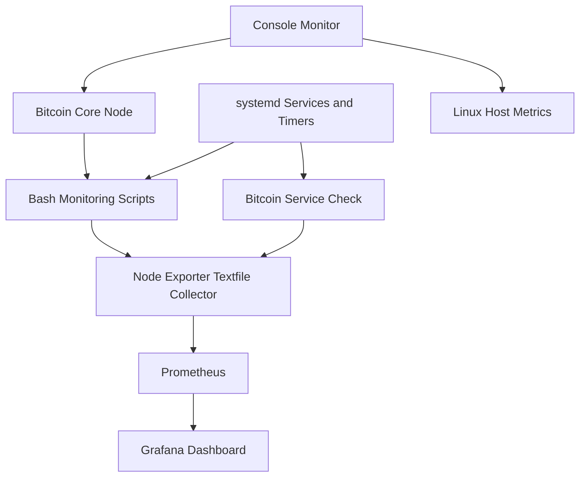
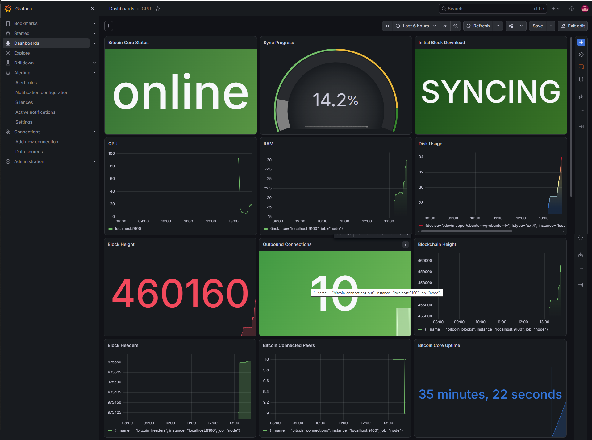
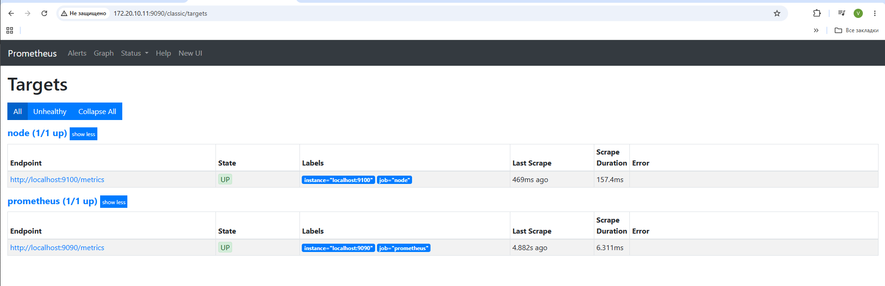
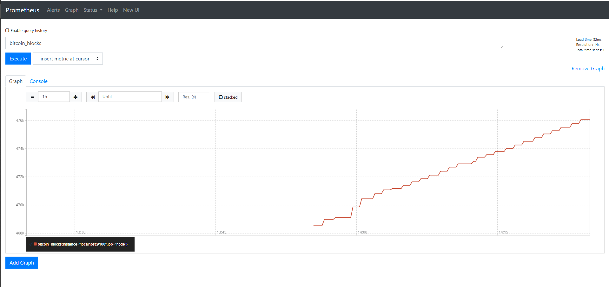
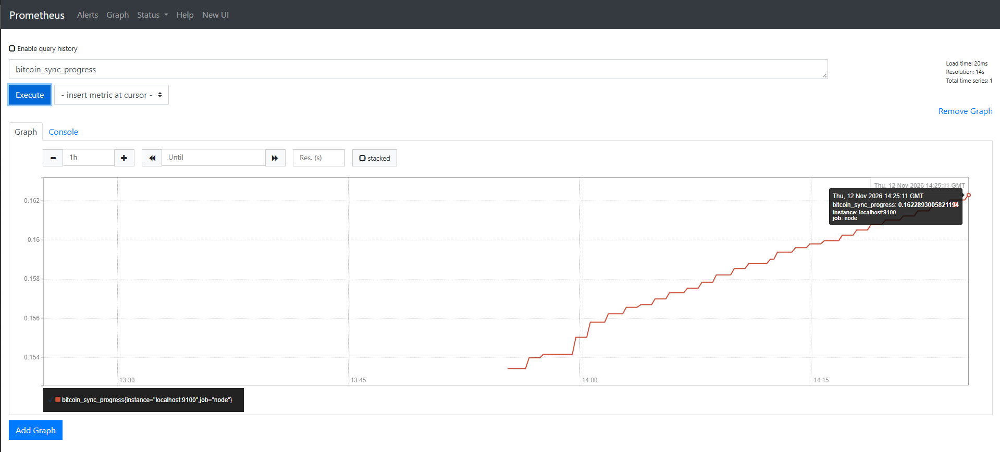

# Bitcoin Node Monitoring

**A Linux infrastructure monitoring project for Bitcoin Core using Bash, systemd, Prometheus and Grafana.**


## Overview

This project implements a monitoring solution for a self-hosted Bitcoin Core full node running on Ubuntu Server.

The solution collects blockchain synchronization, network, service availability and storage metrics using Bash scripts. Metrics are exposed through the Prometheus Node Exporter textfile collector, scraped by Prometheus and visualized in Grafana.

The project demonstrates practical Linux administration, Bash scripting, systemd automation, metrics collection and infrastructure monitoring.

## Architecture



### Monitoring workflow

1. Bitcoin Core provides blockchain and network information through RPC.
2. Bash scripts collect node metrics and check systemd service status.
3. Metrics are written in Prometheus exposition format.
4. Node Exporter exposes the metrics through its HTTP endpoint.
5. Prometheus periodically scrapes Node Exporter.
6. Grafana visualizes the collected data.

## Features

- Bitcoin blockchain synchronization monitoring.
- Block height and header tracking.
- Synchronization progress monitoring.
- Network connection monitoring.
- Bitcoin Core systemd service availability checks.
- Blockchain and chainstate storage monitoring.
- Pruned node configuration monitoring.
- Automated metrics collection using systemd timers.
- Console-based monitoring report.
- Grafana dashboards and Prometheus integration.

## Technology Stack

| Component | Technology |
|---|---|
| Operating system | Ubuntu Server |
| Blockchain node | Bitcoin Core 32.1.0 |
| Scripting | Bash |
| Automation | systemd services and timers |
| Metrics collection | Node Exporter Textfile Collector |
| Monitoring | Prometheus |
| Visualization | Grafana |
| Data processing | jq, awk |
| Version control | Git, GitHub |

## Project Structure

```text
bitcoin-node-monitoring/
├── prometheus/
│   └── prometheus.yml
│
├── scripts/
│   ├── bitcoin_metrics.sh
│   ├── bitcoin_service_check.sh
│   └── monitor.sh
│
├── systemd/
│   ├── bitcoind.service
│   ├── bitcoin-metrics.service
│   ├── bitcoin-metrics.timer
│   ├── bitcoin-service-check.service
│   └── bitcoin-service-check.timer
│
├── screenshots/
│   ├── grafana-dashboard.png
│   ├── prometheus-targets.png
│   └── terminal-monitor.png
│
├── .gitignore
└── README.md
```

## Exported Metrics

The monitoring scripts expose the following custom Prometheus metrics.

| Metric | Description |
|---|---|
| `bitcoin_blocks` | Current blockchain height |
| `bitcoin_headers` | Number of known block headers |
| `bitcoin_blocks_behind` | Difference between headers and blocks |
| `bitcoin_sync_progress` | Blockchain synchronization progress |
| `bitcoin_initial_block_download` | Initial block download status |
| `bitcoin_connections` | Total network connections |
| `bitcoin_connections_in` | Incoming connections |
| `bitcoin_connections_out` | Outgoing connections |
| `bitcoin_uptime_seconds` | Bitcoin Core uptime |
| `bitcoin_blocks_size_bytes` | Blockchain storage size |
| `bitcoin_chainstate_size_bytes` | Chainstate storage size |
| `bitcoin_pruned` | Pruned node status |
| `bitcoin_systemd_service_up` | Bitcoin Core systemd service status |

## Monitoring

### Prometheus

Prometheus collects metrics from Node Exporter and its own monitoring endpoint.

Example scrape configuration:

```yaml
global:
  scrape_interval: 15s
  evaluation_interval: 15s

scrape_configs:
  - job_name: prometheus
    scrape_interval: 5s
    static_configs:
      - targets:
          - localhost:9090

  - job_name: node
    static_configs:
      - targets:
          - localhost:9100
```

### Example PromQL Queries

**Current block height**
```promql
bitcoin_blocks
```

**Blockchain synchronization progress**
```promql
bitcoin_sync_progress * 100
```

**Blocks remaining**
```promql
bitcoin_blocks_behind
```

**Network connections**
```promql
bitcoin_connections
```

**Bitcoin Core service status**
```promql
bitcoin_systemd_service_up
```

**Blockchain storage**
```promql
bitcoin_blocks_size_bytes
```

### Grafana

Grafana is used to visualize the collected metrics.

The dashboard can display:

- Blockchain synchronization progress.
- Current block height.
- Remaining blocks.
- Network connections.
- Bitcoin Core service availability.
- Blockchain storage usage.
- Node uptime.

## Console Monitoring

The `monitor.sh` script provides a terminal-based monitoring report.

It displays:

- Bitcoin blockchain status.
- Synchronization progress.
- Network connections.
- Pruned node configuration.
- Blockchain data directory size.
- System memory and swap usage.
- CPU load.
- Available disk space.

Run the script:

```bash
sudo ./scripts/monitor.sh
```

## Automation

Metrics collection is automated using systemd services and timers.

| Unit | Purpose |
|---|---|
| `bitcoin-metrics.service` | Collects Bitcoin Core metrics |
| `bitcoin-metrics.timer` | Runs metrics collection periodically |
| `bitcoin-service-check.service` | Checks Bitcoin Core service status |
| `bitcoin-service-check.timer` | Schedules service status checks |
| `bitcoind.service` | Manages Bitcoin Core |

The metrics collection and service health check are separated into independent systemd units.

This allows service availability to be monitored even when Bitcoin Core is stopped.

## Screenshots

### Grafana Dashboard



### Prometheus Targets








## Security Considerations

- Bitcoin Core runs under a dedicated Linux user.
- Monitoring scripts use controlled permissions.
- Metrics files are written atomically.
- RPC credentials are not stored in the Git repository.
- Local configuration files and sensitive certificates are excluded through `.gitignore`.
- Monitoring scripts and systemd units run with explicitly defined privileges.

## Key Engineering Decisions

**Atomic metrics updates**

Temporary files and atomic file replacement help prevent Prometheus from reading partially written metrics.

**Separation of responsibilities**

Blockchain metrics collection and systemd service health checks are handled independently.

**Automated execution**

systemd timers eliminate the need for manual metrics collection.

**Prometheus-compatible output**

Metrics are exported in a format supported by the Node Exporter textfile collector.

## Project Goals

This project was created as a practical DevOps learning and portfolio project to demonstrate:

- Linux server administration.
- Bash scripting and automation.
- systemd service management.
- Prometheus metrics collection.
- Grafana monitoring and visualization.
- Infrastructure troubleshooting.
- Git and GitHub workflows.

## Project Status

The monitoring infrastructure and metrics collection scripts have been implemented.

The project is being documented and prepared for portfolio presentation.

---

**Author:** [Vladimir Derzhanskii](https://github.com/root93phpdev)

**GitHub:** [bitcoin-node-monitoring](https://github.com/root93phpdev/bitcoin-node-monitoring)