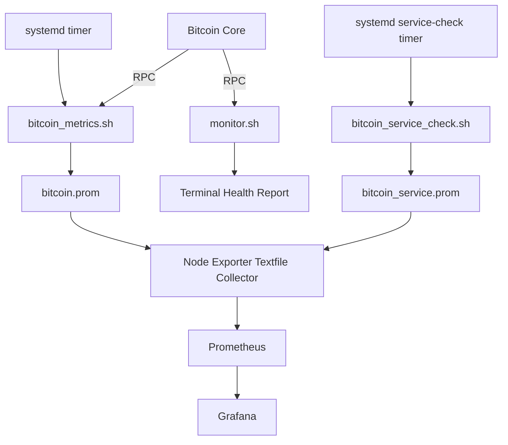

# Bitcoin Node Monitoring

A self-hosted monitoring solution for a Bitcoin Core node on Ubuntu Server, built with Bash, systemd, Prometheus, Node Exporter and Grafana.

The project collects blockchain and peer-network metrics through Bitcoin Core RPC, exposes them using the Node Exporter textfile collector, and makes them available to Prometheus and Grafana.

## Features

- Bitcoin blockchain height and known headers
- Blockchain synchronization progress
- Blocks behind and initial block download status
- Total, inbound and outbound peer connections
- Bitcoin Core uptime
- Blocks and chainstate directory sizes
- Independent Bitcoin Core systemd service monitoring
- Atomic Prometheus metrics file updates
- Automated collection with systemd timers
- Terminal-based node and host health report

## Architecture



## Technology Stack

| Technology | Purpose |
|---|---|
| Ubuntu Server | Operating system |
| Bitcoin Core | Bitcoin node and RPC interface |
| Bash | Metrics collection and automation |
| systemd | Service management and scheduling |
| Node Exporter | Host metrics and textfile metrics |
| Prometheus | Metrics collection |
| Grafana | Dashboard visualization |
| Git | Version control |

## Project Structure

```text
bitcoin-node-monitoring/
├── prometheus/
│   └── prometheus.yml
├── scripts/
│   ├── bitcoin_metrics.sh
│   ├── bitcoin_service_check.sh
│   └── monitor.sh
├── systemd/
│   ├── bitcoind.service
│   ├── bitcoin-metrics.service
│   ├── bitcoin-metrics.timer
│   ├── bitcoin-service-check.service
│   └── bitcoin-service-check.timer
├── screenshots/
├── .gitignore
└── README.md
```

## Exported Metrics

| Metric | Description |
|---|---|
| `bitcoin_blocks` | Current validated block height |
| `bitcoin_headers` | Number of known block headers |
| `bitcoin_blocks_behind` | Difference between headers and validated blocks |
| `bitcoin_sync_progress` | Blockchain verification progress, from 0 to 1 |
| `bitcoin_initial_block_download` | Initial block download status |
| `bitcoin_connections` | Total peer connections |
| `bitcoin_connections_in` | Inbound peer connections |
| `bitcoin_connections_out` | Outbound peer connections |
| `bitcoin_uptime_seconds` | Bitcoin Core uptime |
| `bitcoin_blocks_size_bytes` | Blocks directory size |
| `bitcoin_chainstate_size_bytes` | Chainstate directory size |
| `bitcoin_pruned` | Whether pruning is enabled |
| `bitcoin_systemd_service_up` | Whether the Bitcoin Core systemd service is active |

## Requirements

- Ubuntu Server with systemd
- Bitcoin Core
- Prometheus
- Node Exporter with textfile collector enabled
- Grafana
- `jq`, `sudo`, `runuser`, `awk`, `du` and standard Linux utilities

The example configuration assumes:

- Bitcoin service user: `bitcoin`
- Bitcoin CLI: `/usr/local/bin/bitcoin-cli`
- Bitcoin data directory: `/var/lib/bitcoin/.bitcoin`
- Node Exporter textfile directory: `/var/lib/prometheus/node-exporter`
- Node Exporter group: `prometheus`
- Project installation directory: `/opt/bitcoin-node-monitoring`

Adapt these values to your environment.

## Installation

### 1. Install dependencies

```bash
sudo apt update
sudo apt install -y jq
```

### 2. Clone the repository

```bash
sudo git clone https://github.com/root93phpdev/bitcoin-node-monitoring.git /opt/bitcoin-node-monitoring
```

### 3. Prepare the metrics directory

```bash
sudo install -d -o root -g prometheus -m 0750 \
  /var/lib/prometheus/node-exporter
```

Ensure the Node Exporter process can read this directory and its metric files.

### 4. Configure Node Exporter

Enable the textfile collector with:

```text
--collector.textfile.directory=/var/lib/prometheus/node-exporter
```

Add this option to the existing Node Exporter service configuration.

### 5. Configure Prometheus

Use the scrape configuration in:

```text
prometheus/prometheus.yml
```

Merge the required scrape jobs into your existing Prometheus configuration if necessary.

### 6. Install systemd units

```bash
sudo cp /opt/bitcoin-node-monitoring/systemd/bitcoin-metrics.service /etc/systemd/system/
sudo cp /opt/bitcoin-node-monitoring/systemd/bitcoin-metrics.timer /etc/systemd/system/

sudo cp /opt/bitcoin-node-monitoring/systemd/bitcoin-service-check.service /etc/systemd/system/
sudo cp /opt/bitcoin-node-monitoring/systemd/bitcoin-service-check.timer /etc/systemd/system/
```

Reload systemd and enable the timers:

```bash
sudo systemctl daemon-reload

sudo systemctl enable --now bitcoin-metrics.timer
sudo systemctl enable --now bitcoin-service-check.timer
```

The included `bitcoind.service` is a reference configuration. Review it before using it on an existing Bitcoin Core installation.

## Console Monitoring

Run the terminal health report:

```bash
sudo /opt/bitcoin-node-monitoring/scripts/monitor.sh
```

The report includes:

- Blockchain height and synchronization
- Peer connections
- Blockchain storage usage
- RAM and swap usage
- CPU load
- Disk usage

These console values are not custom Prometheus metrics.

## Prometheus Queries

Bitcoin block height:

```promql
bitcoin_blocks
```

Synchronization progress:

```promql
bitcoin_sync_progress * 100
```

Blocks behind:

```promql
bitcoin_blocks_behind
```

Peer connections:

```promql
bitcoin_connections
```

Inbound connections:

```promql
bitcoin_connections_in
```

Outbound connections:

```promql
bitcoin_connections_out
```

Bitcoin Core uptime:

```promql
bitcoin_uptime_seconds
```

Blocks storage:

```promql
bitcoin_blocks_size_bytes
```

Chainstate storage:

```promql
bitcoin_chainstate_size_bytes
```

Bitcoin Core service status:

```promql
bitcoin_systemd_service_up
```

## Grafana Dashboard

Grafana can be used to visualize:

- Current block height
- Blockchain synchronization progress
- Blocks behind
- Peer connections
- Blockchain storage usage
- Bitcoin Core service status

## Screenshots

Add screenshots from your own environment to the `screenshots/` directory.

Suggested files:

- `grafana-dashboard.png`
- `prometheus-targets.png`
- `terminal-monitor.png`

## Security

- Never commit Bitcoin RPC credentials or `bitcoin.conf`.
- Do not expose Bitcoin RPC publicly without appropriate protection.
- Restrict access to Prometheus, Node Exporter and Grafana.
- Review file ownership and permissions before deployment.

## Project Goals

This project demonstrates practical experience with:

- Linux server administration
- Bash scripting
- Bitcoin Core RPC
- systemd services and timers
- Prometheus metrics exposition
- Node Exporter textfile collector
- Grafana dashboards
- Infrastructure monitoring and automation

## Status

A practical Bitcoin Core monitoring lab project. Configuration paths and service names should be adapted to the target environment before deployment.
