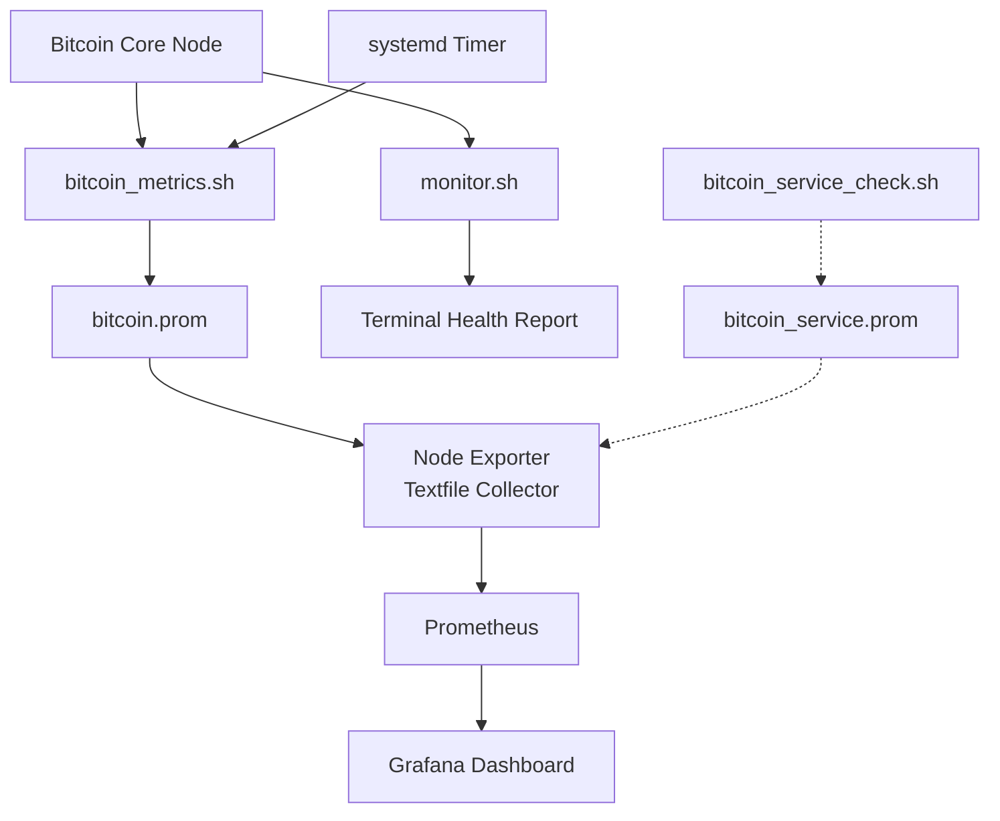

# Bitcoin Node Monitoring

A self-hosted monitoring solution for a Bitcoin Core full node using Bash, Prometheus, Node Exporter and Grafana.

The project collects blockchain synchronization metrics, peer connection statistics, Bitcoin Core service status and system health information.

## Overview

This project demonstrates Linux server administration, Bash scripting, systemd service management and infrastructure monitoring.

### Key Features

- Bitcoin blockchain synchronization monitoring
- Current block height and known headers
- Blockchain synchronization progress
- Peer connection statistics
- Blockchain storage usage
- Bitcoin Core systemd service monitoring
- Automated metrics collection
- Prometheus metrics integration
- Grafana dashboard visualization
- Console-based server health report


## Architecture

The monitoring pipeline collects Bitcoin Core metrics and exposes them to Prometheus through the Node Exporter textfile collector.



### Data Flow

1. Bitcoin Core provides blockchain and network information through RPC.
2. Bash scripts collect monitoring data.
3. Metrics are written in Prometheus exposition format.
4. Node Exporter exposes metrics through its textfile collector.
5. Prometheus periodically scrapes Node Exporter.
6. Grafana visualizes the collected metrics.


## Technologies

| Technology | Purpose |
|---|---|
| Ubuntu Server | Operating system |
| Bitcoin Core | Bitcoin full node |
| Bash | Monitoring automation |
| systemd | Service management and scheduling |
| Node Exporter | Metrics exposition |
| Prometheus | Metrics collection |
| Grafana | Monitoring dashboards |
| Git | Version control |

## Project Structure

```text
bitcoin-node-monitoring/
├── prometheus/
│   └── prometheus.yml
├── scripts/
│   ├── bitcoin_metrics.sh
│   ├── bitcoin_service_check.sh
│   └── monitor.sh
├── systemd/
│   ├── bitcoind.service
│   ├── bitcoin-metrics.service
│   └── bitcoin-metrics.timer
├── screenshots/
├── .gitignore
└── README.md
```

## Exported Metrics

| Metric | Description |
|---|---|
| `bitcoin_blocks` | Current validated block height |
| `bitcoin_headers` | Known block headers |
| `bitcoin_blocks_behind` | Difference between headers and blocks |
| `bitcoin_sync_progress` | Blockchain synchronization progress |
| `bitcoin_initial_block_download` | Initial block download status |
| `bitcoin_connections` | Total peer connections |
| `bitcoin_connections_in` | Inbound peer connections |
| `bitcoin_connections_out` | Outbound peer connections |
| `bitcoin_uptime_seconds` | Bitcoin Core uptime |
| `bitcoin_blocks_size_bytes` | Blocks directory size |
| `bitcoin_chainstate_size_bytes` | Chainstate directory size |
| `bitcoin_pruned` | Pruning enabled status |
| `bitcoin_service_up` | Bitcoin Core service status |

The separate service check script also provides:

- `bitcoin_systemd_service_up` — systemd service status.

## Monitoring

Metrics are exposed through the Node Exporter textfile collector and collected by Prometheus.

Grafana is used to visualize:

- Blockchain synchronization progress
- Block height and headers
- Peer connections
- Storage consumption
- Bitcoin Core service status

## Console Monitoring

The `monitor.sh` script provides a terminal-based health report, including:

- Bitcoin blockchain status
- Peer connections
- RAM and swap usage
- CPU load
- Disk space
- Bitcoin data directory size

## Screenshots

Screenshots of the Grafana dashboard and Prometheus interface will be added here.

## Project Goals

This project was created as a practical DevOps learning project to demonstrate:

- Linux server administration
- Bash scripting and automation
- systemd service configuration
- Prometheus metrics integration
- Infrastructure monitoring
- Git-based project management

## Status

The monitoring infrastructure is implemented. Documentation, deployment instructions and additional improvements are in progress.
